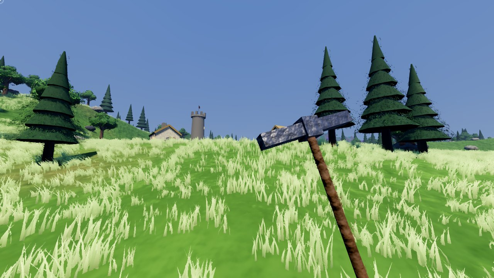
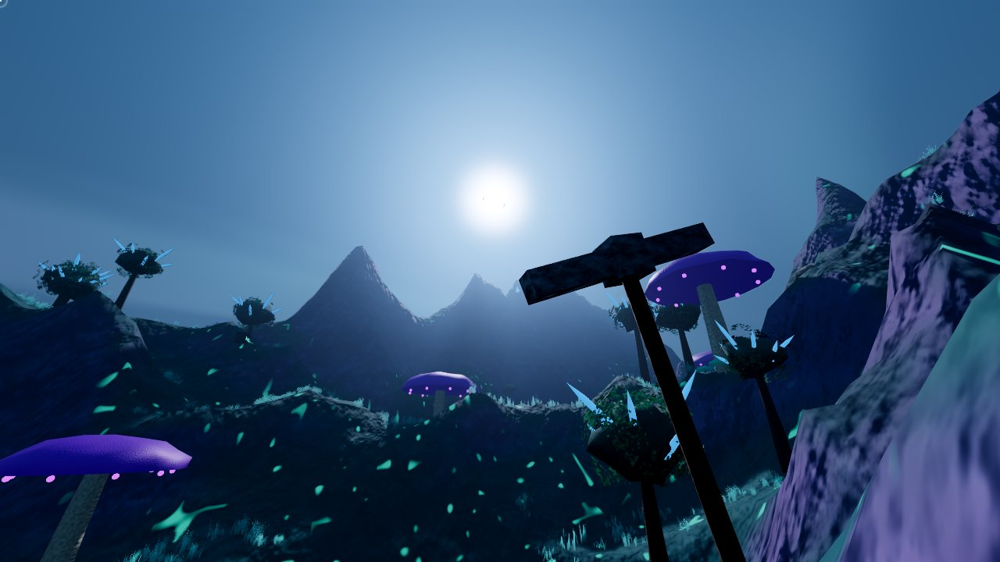
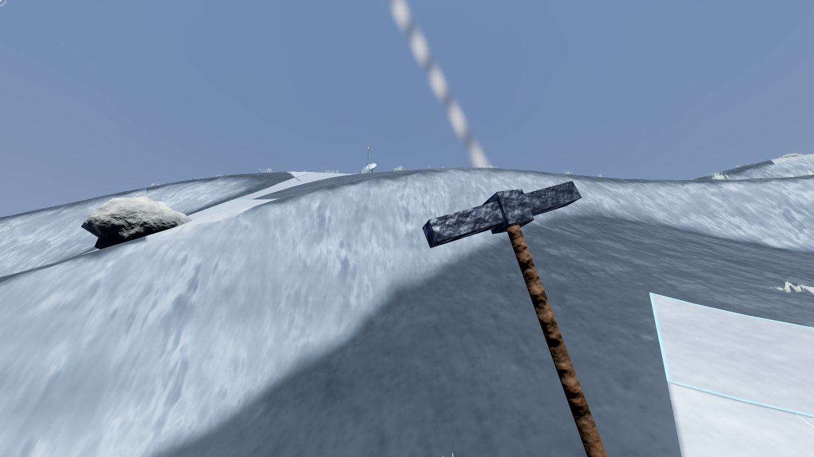
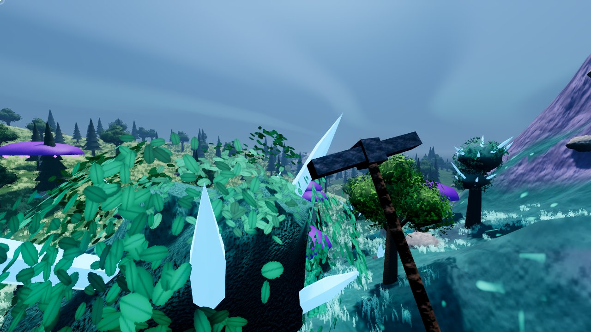
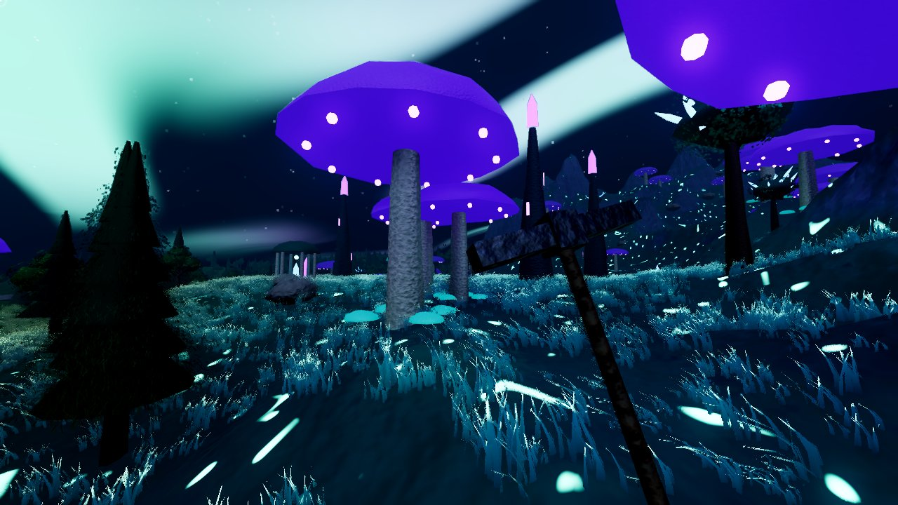
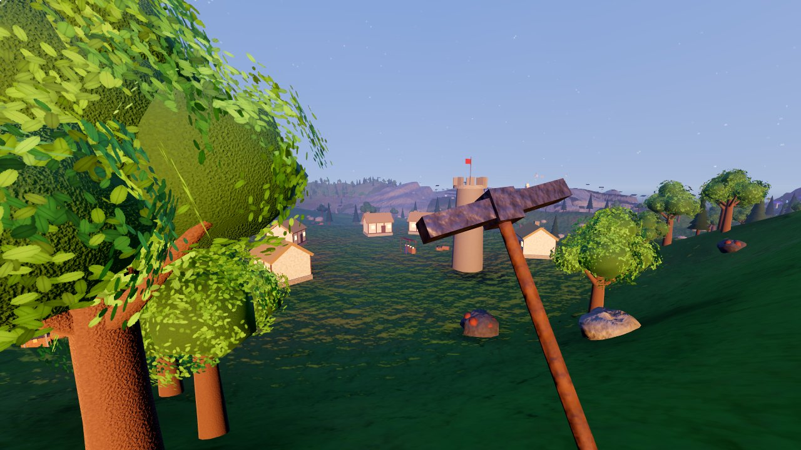

# Procedural World

A free and open-source first-person game set in one infinite world that is generated as you
walk. Medieval countryside gives way to glowing fantasy wildwood, which gives way to a sci-fi
frontier of alloy plateaus, and every crossing blends smoothly instead of snapping.

**Once it exists, it exists.** Every hill, tree, ruin, chest, trader and item the world
generates is saved the first time it appears and is never regenerated. The tree you felled,
the crater you dug, the chest you emptied and every item in your pack (with where and when you
got it) stay exactly as you left them, forever.

> Status: early vertical slice (v0.1). The world, persistence, tools, crafting, trading,
> settings and Windows installer work. Visuals are a first pass built entirely from
> procedural geometry; the fidelity roadmap is in [docs/ROADMAP.md](docs/ROADMAP.md).

## Screenshots

First-pass visuals from the automated screenshot tour (software-rendered in CI, no GPU):

| | |
|---|---|
|  |  |
|  |  |
|  |  |

## Features

- Infinite streamed terrain in 64 m chunks, generated on worker threads.
- Three eras with continuous blending of terrain, materials, vegetation, fog and sky.
- Settlements with traders whose prices depend on where goods come from and how much you
  have already sold them.
- Pickaxes, axes, swords and a pulse pistol; mining, chopping and persistent digging.
- 14 crafting recipes; items carry provenance ("Mined in Ashford Vale on day 3").
- An Atlas of every place you have ever seen.
- Forward+ rendering: SDFGI global illumination, volumetric fog, SSAO, SSR, TAA/FSR 2.2,
  ACES tonemapping, auto-exposure, day/night cycle.
- Full graphics settings with Low/Medium/High/Ultra presets.
- Windows installer with Start Menu and desktop shortcuts and a clean uninstaller.

## Recommended hardware

NVIDIA RTX 3070 or better, an 8-core desktop CPU, 32 GB RAM, Windows 10/11 64-bit, SSD.
(Design target; see the roadmap for what has and has not been measured.)

## Controls

| Action | Key |
|---|---|
| Move / sprint / crouch / jump | WASD / Shift / Ctrl / Space |
| Use tool or weapon | Left mouse |
| Interact, open, trade | E |
| Eat | F |
| Inventory / Crafting / Atlas | Tab / R / M |
| Hotbar | 1 to 6, mouse wheel |
| Pause and settings | Esc |
| Screenshot / FPS counter | F12 / F3 |

## Install

Download `ProceduralWorld-<version>-Setup.exe` from the Releases page and run it, or use the
portable zip. Saved worlds live in `%APPDATA%\ProceduralWorld`.

## Build from source

1. Install [Godot 4.5.1](https://godotengine.org/download) and its export templates.
2. Open the folder in Godot and press Play, or run `godot --path .`.
3. Tests: `godot --headless --path . --script res://tests/run_tests.gd`
4. Windows/Linux builds and the installer (needs NSIS): `./tools/build.sh`
5. Screenshot tour: `godot --path . res://src/world/world.tscn -- --capture --seed=1`

## Layout

```
docs/          design spec and roadmap
src/core/      hashing, global game state and saving
src/world/     world field, chunk generation, streaming, meshes, materials, shaders
src/persistence/ on-disk world store
src/items/     item definitions, inventory, recipes
src/economy/   trader pricing and stock
src/player/    first-person controller and held items
src/env/       sky, sun, fog
src/ui/        HUD, menus, settings
tests/         headless test suite
installer/     NSIS Windows installer
tools/         build script, screenshot tour
```

## License

MIT. See [LICENSE](LICENSE).
